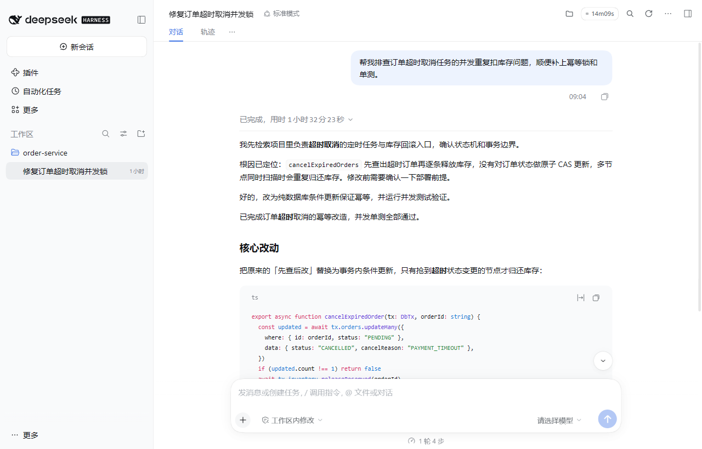
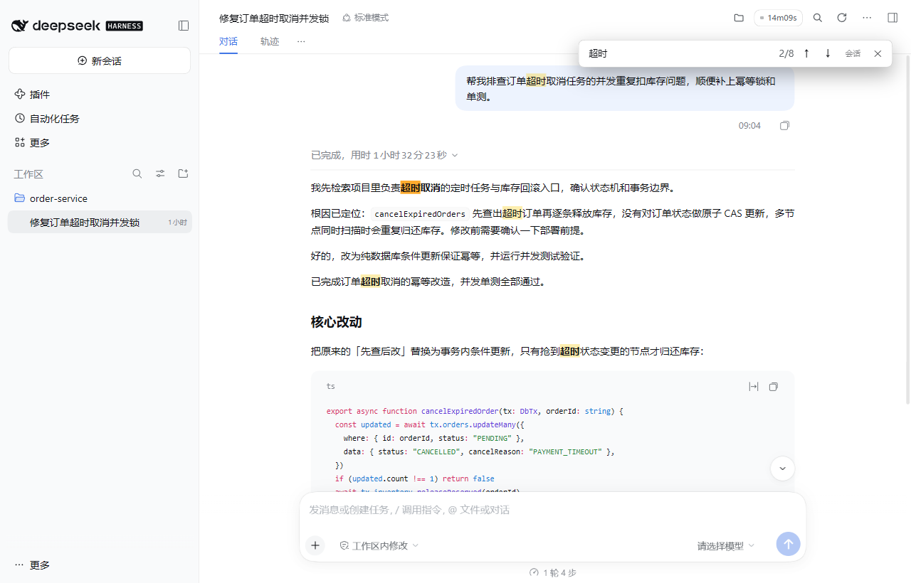

# dsh-workbench

DSH 桌面端工作台插件，解决长任务跑起来之后最常见的五个小痛点。



| 功能 | 入口 | 说明 |
|---|---|---|
| **AI 工作时长** | 会话头部徽章 | 扣掉等你审批和回答的时间，只算 AI 实际干活的时长；点开看分项与工具明细 |
| **需要确认时提醒** | 设置 → 会话工作台 | 审批或提问弹窗出现后按间隔反复响铃，处理后自动停；支持自定义音效 |
| **会话内查找** | 头部放大镜按钮 / 快捷键 | 页内高亮、实时计数、上下跳转，默认只搜当前会话可见正文 |
| **打开工作区目录** | 会话头部文件夹按钮 | 直接在系统文件管理器里打开当前会话所在目录 |
| **刷新页面** | 会话头部刷新按钮 | 一键重载界面，装卸或修改插件后不必重启 DSH |

## 界面预览

| 耗时分解 | 会话内查找 |
|---|---|
|  |  |

| 需要确认时提醒 |
|---|
|  |

> 以上均为演示环境效果截图，仅用于展示界面与功能，实际数据与显示效果以安装后的客户端为准。

## 解决什么问题

### 1. AI 工作时长：看清 AI 到底忙了多久

跑长任务时去倒水、开会甚至睡一觉，回来发现任务停在审批或提问弹窗上。DSH 自带统计会把这段你不在电脑前的时间算进耗时——在一次实测会话里，提问等待占了 73.9 分钟，系统把整段算成 158.8 分钟；扣掉人工等待后，AI 实际只干了 84.9 分钟。

点开头部时长徽章可以看到完整分解：

- **主数值**：AI 实际工作时长（已扣除等待审批与等待回答）
- **分项耗时**：模型输出、工具执行、等待你审批、等待你回答、步骤总跨度
- **工具明细**：按工具统计调用次数与总耗时（提问等待单独列出，不混入工具列表）

### 2. 需要确认时提醒：别让弹窗卡一整晚

长任务最怕的正是上面那种情况：放着项目跑，人离开工位或切去忙别的，审批或提问弹窗弹出来时，常见提示音只响一声、错过不候，等想起回来看才发现早就停在半路。

本插件在弹窗出现时会立即响铃一次，之后按设定间隔持续响铃，直到你处理完弹窗自动停止；超过最长提醒时长也会自动停，不会一直吵。

在 **设置 → 会话工作台** 中可调整：

| 设置项 | 说明 |
|---|---|
| **需要确认时提醒** | 总开关（默认开启） |
| **提醒间隔** | 3–600 秒，默认 15 秒 |
| **最长提醒** | 默认 600 秒，设为 0 表示不限 |
| **提示音** | 内置「清脆双音」「短促脉冲」「柔和铃音」，支持导入 4 MB 以内的本地音频并试听 |
| **音量** | 0–100%，默认 60%，内置音与自定义音频均生效 |

### 3. 会话内查找：长对话里直接翻到那一行

几十轮的长会话里想找回之前提到过的文件名或报错，默认查找容易把折叠的思考过程和输入框草稿一起搜出来。

- **打开方式**：点击头部放大镜按钮，或按 `Ctrl+Alt+Shift+F` / `Ctrl+Shift+F`（避开 DSH 默认的 `Ctrl+F`）
- **快捷操作**：`Enter` / `↓` 下一处，`Shift+Enter` / `↑` 上一处，`Esc` 关闭；选中文字后打开会自动填入搜索词
- **搜索范围**：默认只搜当前会话可见正文，点击查找条上的「会话 / 整页」可切换全页搜索
- **浏览体验**：高亮不影响页面排版，AI 流式输出时计数自动更新，手动滚动不会被拉回

### 4. 打开工作区目录：一步拿到产出文件

AI 刚生成了截图、构建产物或日志，想直接拖给别人或用外部软件打开，不必一层层翻路径——点会话头部的文件夹按钮，直接在系统文件管理器里打开当前项目目录。

### 5. 刷新页面：改完插件不用重启客户端

新增、卸载或改名插件后，页面里缓存的插件清单还是旧的。点会话头部最右侧的圆形箭头即可重载界面，不必关掉重开整个 DSH。

## 安装

本插件为纯 JavaScript、零外部依赖、无构建步骤，按使用方式任选一种即可。

### 方式一：DSH 桌面端直接安装（推荐）

1. 打开 DeepSeek Harness 桌面端，进入 **设置 → 插件 → 添加插件**（或左侧栏「插件」）。
2. 在「包名或地址」中输入：

```text
github:SparkforDream/dsh-workbench
```

3. 安装完成后按提示刷新页面或重启桌面端即可生效。

> 桌面端内置插件管理器会自动处理 `desktop` profile 的挂载，无需手动编辑 `cordis.patch.yml`。

### 方式二：Web 端 / CLI 安装

适用于 `dsh web` 或自定义 profile（需要本机 PATH 上有 `pnpm`）：

```sh
# 从 GitHub 安装
dsh plugin --profile web add github:SparkforDream/dsh-workbench

# 或从本地克隆目录安装
dsh plugin --profile web add ./dsh-workbench
```

安装或更新后重启 `dsh web` 生效。卸载命令：

```sh
dsh plugin --profile web remove dsh-workbench
```

> `dsh plugin --profile web` 只写入 `web` profile，不修改桌面端 `desktop` profile；桌面端请使用方式一。

### 方式三：本地开发直连桌面端（Windows PowerShell）

<details>
<summary>展开查看本地目录链接步骤（适合修改源码调试，普通用户请用方式一）</summary>

将本地仓库目录链接到 `desktop` profile：

```pwsh
New-Item -ItemType Junction `
  -Path "$HOME\.dsh\profiles\desktop\node_modules\dsh-workbench" `
  -Target "<你的仓库本地路径>"
```

在 `$HOME\.dsh\profiles\desktop\cordis.patch.yml` 末尾追加（用 `insert:` 新增条目，不要与方式一重复挂载）：

```yaml
- insert:
    - id: ui-workbench
      name: dsh-workbench
```

保存后重启 DSH 生效。

</details>

## 使用说明与限制

- 会话内查找只覆盖当前已加载到页面的消息；查找更早历史时，先向上滚动加载。
- 子代理内部的耗时不并入父会话统计，父会话仅计入该次调用跨度。

## 开发文档

统计口径、源码依据与测试脚本见 [docs/DEVELOPMENT.md](docs/DEVELOPMENT.md)。

## License

MIT
